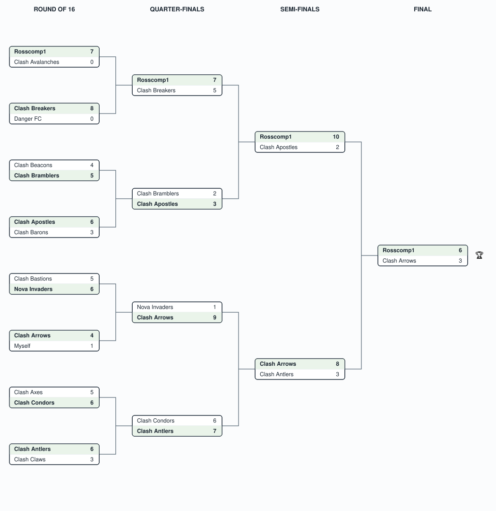

# Agentic Football — NAMER Virtual 2026

## Event Details

- **Event**: AWS AI League — Agentic Football, NAMER Virtual (North America)
- **Date**: September 2026
- **Format**: 16-team single-elimination knockout — Round of 16 → Quarter-finals → Semi-finals → Final
- **Game**: Agentic Football — build a team of AI agents that compete in live matches; head-to-head elimination rather than a scored map run.

## Bracket

Single-elimination: the winner of each match (shaded, in bold) advances to the round on its right. Full per-round scores are in the tables below.

## Results

### Round of 16

| Match | Home | Score | Away | Winner |
|-------|------|-------|------|--------|
| 1 | Rosscomp1 | 7-0 | Clash Avalanches | **Rosscomp1** |
| 2 | Clash Breakers | 8-0 | Danger FC | **Clash Breakers** |
| 3 | Clash Beacons | 4-5 | Clash Bramblers | **Clash Bramblers** |
| 4 | Clash Apostles | 6-3 | Clash Barons | **Clash Apostles** |
| 5 | Clash Bastions | 5-6 | Nova Invaders | **Nova Invaders** |
| 6 | Clash Arrows | 4-1 | Myself | **Clash Arrows** |
| 7 | Clash Axes | 5-6 | Clash Condors | **Clash Condors** |
| 8 | Clash Antlers | 6-3 | Clash Claws | **Clash Antlers** |

### Quarter-finals

| Match | Home | Score | Away | Winner |
|-------|------|-------|------|--------|
| 1 | Rosscomp1 | 7-5 | Clash Breakers | **Rosscomp1** |
| 2 | Clash Bramblers | 2-3 | Clash Apostles | **Clash Apostles** |
| 3 | Nova Invaders | 1-9 | Clash Arrows | **Clash Arrows** |
| 4 | Clash Condors | 6-7 | Clash Antlers | **Clash Antlers** |

### Semi-finals

| Match | Home | Score | Away | Winner |
|-------|------|-------|------|--------|
| 1 | Rosscomp1 | 10-2 | Clash Apostles | **Rosscomp1** |
| 2 | Clash Arrows | 8-3 | Clash Antlers | **Clash Arrows** |

### Final

| Home | Score | Away | Winner |
|------|-------|------|--------|
| Rosscomp1 | 6-3 | Clash Arrows | 🏆 **Rosscomp1** |

**Champion: Rosscomp1** — unbeaten through four rounds, including a 7-0 shutout in the Round of 16 and a 10-2 semi-final rout of Clash Apostles, before beating Clash Arrows 6-3 in the final. Clash Arrows reached the final on the back of a 9-1 demolition of Nova Invaders in the quarter-finals.

### A note on the quarter-final: a DeepRacer reunion

The quarter-final between **Rosscomp1** and **Clash Breakers** was a reunion of two former AWS DeepRacer racers: Rosscomp1 against **Polish Thunder** (aka **Daryl Jezierski**). Daryl took an early lead before Rosscomp1 turned the game around to win 7-5 — the tightest match of Rosscomp1's title run.
